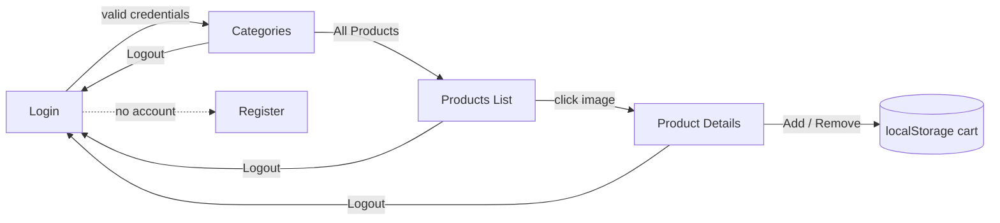

<div align="center">

# 🐾 CatHub — Product Categories Store

**A modern e-commerce storefront built with Angular 20, featuring authentication, route guards, category browsing, product details, and a persistent cart counter.**

[](https://angular.dev)
[](https://www.typescriptlang.org)
[](https://rxjs.dev)
[](https://getbootstrap.com)
[](https://naiw991uen-collab.github.io/catigories/)

### 🌐 [Live Demo](https://naiw991uen-collab.github.io/catigories/)

</div>

---

## 📖 Overview

**CatHub** is a single-page shopping application that consumes the [DummyJSON](https://dummyjson.com) REST API. Users sign in, browse all product categories, drill into the products of any category, and open a detailed product page where they can add or remove items from their cart.

The project demonstrates the core building blocks of a modern Angular application: **standalone components**, **signals**, the new **control-flow syntax** (`@if` / `@for`), **reactive forms**, **functional route guards**, and a shared **service layer** built on `HttpClient` and RxJS.

---

## ✨ Features

| Feature | Description |
|---|---|
| 🔐 **Authentication** | Login form connected to the DummyJSON auth endpoint (`POST /user/login`). |
| 🛡️ **Protected Routes** | A functional `CanActivate` guard blocks unauthenticated access to categories and products. |
| 🗂️ **Category Browsing** | Fetches all product categories and displays them as image cards. |
| 🛍️ **Products by Category** | Dynamic route `/products/:category` lists every product in the selected category. |
| 🔎 **Product Details** | Dynamic route `/single/:id` shows image, title, price, and description. |
| 🛒 **Cart Counter** | Add / remove a chosen quantity; the count is saved per product in `localStorage`. |
| 🧭 **Smart Navbar** | Shows *Login / Register* or *Cat / Logout* depending on authentication state. |
| ⏳ **Loading & Error States** | Every data view handles loading and error states with Angular signals. |
| 📱 **Responsive Layout** | Bootstrap 5 grid adapts from mobile to desktop. |

---

## 🛠️ Tech Stack

- **Framework:** Angular 20 (standalone components, signals, new control flow)
- **Language:** TypeScript 5.9
- **State & Async:** RxJS 7.8 (`BehaviorSubject`, `Observable`)
- **Forms:** Angular Reactive Forms + `ngModel`
- **Styling:** Bootstrap 5.3 + custom CSS
- **API:** [DummyJSON](https://dummyjson.com)
- **Testing:** Karma + Jasmine
- **Hosting:** GitHub Pages (built into `/docs`)

---

## 🗺️ Application Routes

| Path | Component | Protected | Description |
|---|---|:---:|---|
| `/` | — | — | Redirects to `/login` |
| `/login` | `Login` | ❌ | User sign-in |
| `/register` | `Register` | ❌ | Registration form |
| `/cat` | `Category` | ✅ | All product categories |
| `/products/:category` | `Products` | ✅ | Products in a category |
| `/single/:id` | `SingleProduct` | ✅ | Product details & cart |
| `**` | `Login` | ❌ | Fallback for unknown routes |

---

## 🔄 User Flow



---

## 📁 Project Structure

```
catigories/
├── docs/                      # Production build served by GitHub Pages
├── public/                    # Static assets (favicon)
├── src/
│   ├── app/
│   │   ├── category/          # Category grid page
│   │   ├── login/             # Login page (reactive form)
│   │   ├── navbar/            # Auth-aware navigation bar
│   │   ├── products/          # Products-by-category page
│   │   ├── register/          # Registration page (reactive form)
│   │   ├── single-product/    # Product details + cart counter
│   │   ├── data-sevice.ts     # HTTP service + auth state (BehaviorSubject)
│   │   ├── omar-guard.ts      # Functional route guard
│   │   ├── app.routes.ts      # Route definitions
│   │   ├── app.config.ts      # Router & HttpClient providers
│   │   └── app.ts / app.html  # Root component
│   ├── index.html             # Bootstrap CDN, meta tags
│   ├── main.ts                # Application bootstrap
│   └── styles.css             # Global styles
├── angular.json
├── package.json
└── tsconfig*.json
```

---

## 🔌 API Endpoints Used

All requests go through `DataSevice`:

| Method | Endpoint | Purpose |
|---|---|---|
| `GET` | `https://dummyjson.com/products/category-list` | List all categories |
| `GET` | `https://dummyjson.com/products/category/{category}` | Products in a category |
| `GET` | `https://dummyjson.com/products/{id}` | Single product details |
| `POST` | `https://dummyjson.com/user/login` | Authenticate user |

---

## 🚀 Getting Started

### Prerequisites

- [Node.js](https://nodejs.org) **20.19+** (or 22.12+)
- [Angular CLI](https://angular.dev/tools/cli) **20**

```bash
npm install -g @angular/cli
```

### Installation

```bash
# 1. Clone the repository
git clone https://github.com/naiw991uen-collab/catigories.git
cd catigories

# 2. Install dependencies
npm install

# 3. Start the development server
npm start
```

Open **http://localhost:4200** in your browser.

### 🔑 Demo Credentials

Login uses DummyJSON's test users. For example:

```
Username: emilys
Password: emilyspass
```

> More test users are available at [dummyjson.com/users](https://dummyjson.com/users).

---

## 📜 Available Scripts

| Command | Description |
|---|---|
| `npm start` | Run the dev server at `localhost:4200` |
| `npm run build` | Production build into `dist/` |
| `npm run watch` | Rebuild on file changes (development config) |
| `npm test` | Run unit tests with Karma |

---

## 🌍 Deployment (GitHub Pages)

The site is served from the `/docs` folder on the `main` branch. To redeploy:

```bash
ng build --output-path docs --base-href /catigories/
# Angular 17+ puts files under docs/browser — move them up one level:
mv docs/browser/* docs/ && rmdir docs/browser

git add docs
git commit -m "Deploy to GitHub Pages"
git push
```

Then in **Settings → Pages**, set the source to **`main` branch / `/docs` folder**.

---

## 🧩 Key Implementation Details

- **Auth state** is held in a `BehaviorSubject<boolean>` (`islogined`) inside `DataSevice`; both the navbar and the route guard subscribe to it.
- **Route guard** (`omarGuard`) is a modern functional `CanActivateFn` that uses `inject()` and redirects to `/login` when the user is not authenticated.
- **Signals** (`signal()`) drive the `isLoading`, `error`, and data state in every page component.
- **Cart persistence** stores each product's count under the key `cartCount_{id}` in `localStorage`, so quantities survive page reloads.

---

## 🧭 Roadmap

- [ ] Persist the login token (e.g. `localStorage`) so a page refresh keeps the user signed in
- [ ] Connect the Register form to a real API endpoint
- [ ] Add form validation messages to Login & Register
- [ ] Show a login error message for invalid credentials
- [ ] Full cart page with totals across all products
- [ ] Product search and price filtering
- [ ] Replace `any` types with typed interfaces (`Product`, `User`)

---

## 🤝 Contributing

Contributions are welcome!

1. Fork the project
2. Create your feature branch: `git checkout -b feature/amazing-feature`
3. Commit your changes: `git commit -m "Add amazing feature"`
4. Push to the branch: `git push origin feature/amazing-feature`
5. Open a Pull Request

---

## 👤 Author

**naiw991uen-collab**

- GitHub: [@naiw991uen-collab](https://github.com/naiw991uen-collab)

---

<div align="center">

If you found this project helpful, please give it a ⭐ on GitHub!

</div>
